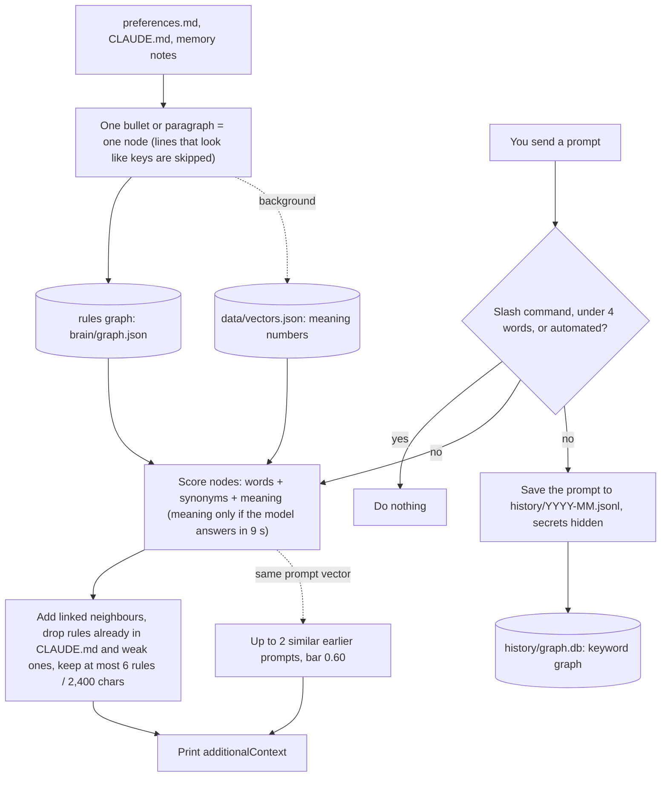
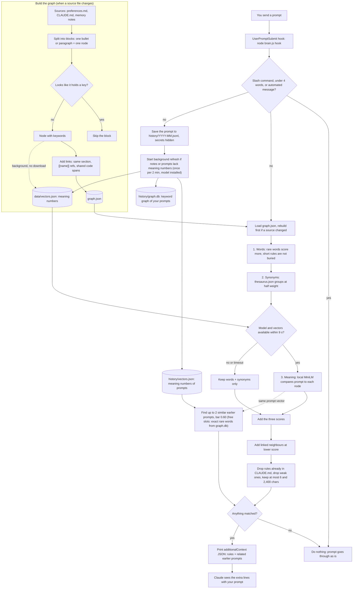
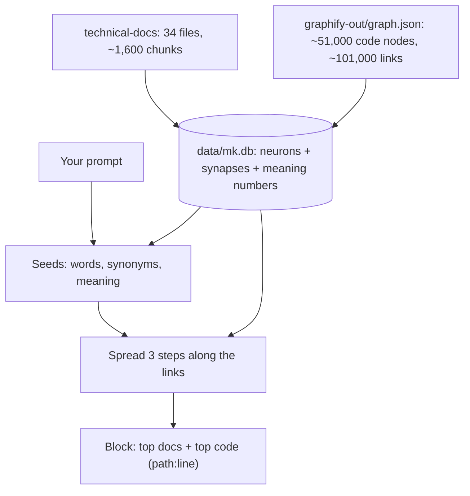

# Brain graph

A `UserPromptSubmit` hook. It reads your rules and memory notes and adds the few that fit each prompt. It also saves your prompts, so it can remind you of an earlier one.

## How it works
In short:

Step by step:

Any error ends in "do nothing" or "words and synonyms only". The hook never blocks a prompt (limit 15 s).

## Matching
Three signals are added:
1. **Words.** A rare word counts more. Short, exact rules are not buried by long notes.
2. **Synonyms.** `thesaurus.json` groups near-equal words ("ship", "push", "commit"). Matches count half. Edit it any time; no rebuild.
3. **Meaning.** A small local model (`all-MiniLM-L6-v2`, 23 MB). Nothing leaves this PC.

## History of your prompts
- **Saved:** prompts of 4 words or more, in `history/YYYY-MM.jsonl`. Not saved: slash commands, short prompts, system messages.
- **Secrets** (keys, tokens, passwords, `Bearer`, JWTs, long random strings) become `[hidden]`. This works by patterns, so an unusual secret can slip through.
- **Use:** a similar earlier prompt (meaning score 0.60 or more) is shown with its date. If a slot is free, an earlier prompt that shares exact rare words (an id or file name like `a-b.md`, or two words seen in 5 prompts or fewer) fills it. A file name counts once, and counts alone only if it is in 2 prompts or fewer. This word lookup reads `graph.db` (its `pw` table keeps every rare word, even from long prompts; 3 ms at 22,000 prompts) and is skipped when that file is missing. A related question may bring back an old one; the date helps you judge it. English works well; other languages weakly.
- **All machines, through git.** Each machine writes its own file (`YYYY-MM.<machine>.jsonl`), so git never conflicts. **Every prompt is pushed, so keep `claude-settings` private.**
- **Forget:** `node brain.js forget "some words"`. It cannot remove what is already committed; old commits keep the text.

## Keyword graph
`history/graph.db` (SQLite, built-in `node:sqlite`, Node 22.5+; without it this part is skipped). A prompt has keywords. Two keywords are linked when they share a prompt; the weight is how many prompts hold both. Numbers and ids are dropped; each prompt keeps its 25 most shared words.

The JSONL is the source of truth. `graph.db` is derived: not in git, safe to delete, rebuilt in the background when prompts change, but only if the model is installed (`graph` and `related` always rebuild it; about 0.3 s at 2,000 prompts and 8 s at 22,000). It does not affect rule ranking. Its only effect on the hook is the exact-word history lookup above.
- `node brain.js graph`: strongest keyword pairs.
- `node brain.js related "word"`: linked keywords and the prompts that hold the word.

## Makillez map (the docs and the code graph as a network)
`mk.js` turns `Makillez-master-docs` into a network of neurons and lets a prompt light a few of them. The light then spreads along the links to related docs and code. The hook adds the strongest ones as a "Makillez map" block, after the rules.

- **Neurons:** doc chunks (about 450 characters, with their heading path), code nodes from the graphify graph, and the graph's communities.
- **Links (synapses):** graphify edges, weighted by kind (`calls`, `implements`, `inherits` strong; `contains`, `method` middle; `references`, `imports` weak). A doc chunk links to the code files and symbols it cites, to the docs it links to, to chunks in its section and to chunks that share a code name.
- **Firing:** seeds come from words and synonyms (rare words count more) and from the meaning model for doc chunks. Light spreads 3 steps. A hub (over 600 links, like `Result`) takes in little and passes nothing on, and each step keeps only the 300 strongest. Code shows one type per file; generic names (`Task`, `Empty`) are skipped.
- **Doc ranking is trained (`rank.json`):** the light finds a pool of about 50 candidate sections. A small model then scores each one from 19 signals (light, word score, heading words, meaning of the chunk, meaning of the heading alone, how much of the question's vocabulary the chunk covers, how a file's other chunks score, file size, first chunk of a file, depth, findings or backlog docs, README and plain-words twins). Weights come from the written-down questions: `node train-rank.js --write` (about 1 min). It uses a ranking loss, so the right sections must score above the others. `node train-rank.js` alone does a leave-one-area-out check (train on all areas but one, test on that one; it scored 94% of 270 doc questions, from 84% without training). The hook shows at most 4 docs, 2 per file and 1 per section. Without `rank.json` the plain light order is used.
- **Code names get their own pass:** the main light is not changed by it (changing code seeds also moves the docs they spread into). Word families join the forms of a word (`sends`, `sender`, `send`; `generated`, `generator`; `change` and `Update`), a class under `TicketAggr/` counts as an aggregate, and a class under `Events/` as an event. A class whose name covers most of the question's known words comes first. The meaning model also reads class names as words (`DomainServiceDomainEventsHolder` -> "domain service domain events holder") and adds the one or two names that are clearly closest.
- **Quiet when unrelated:** the best seed must score 0.65 or more. A question that is very close in meaning to a section title (0.52 or more; unrelated questions never passed 0.47) passes on its own. On the 200 test questions (see "Testing the map" below) Makillez questions score 0.55 to over 2, and unrelated ones 0 to 0.72. No single number separates them perfectly; a missing map costs more than an extra one, so the gate is low. The known near miss is "beginner running plan" (it shares words with the doc section "The run plan").
- **Time:** the whole hook takes about 2 s (search about 0.7 s); the hook limit is 15 s (`settings.json`). The meaning model may use up to 9 s; the map search is skipped after 11 s.
- **Build:** `node --max-old-space-size=4096 brain.js build-mk` (about 25 s). It reads `Makillez-master-docs` from `~/source/repos/Makillez-master-docs`; set `MK_DOCS` for another folder. The hook rebuilds it in the background (at most every 10 minutes) when a doc or `graph.json` changed; the old map keeps serving until then.
- **Look at it:** `node brain.js mk "your text"` prints the block and the time (`--no-meaning` skips the model).
- **Header:** the block names the graph commit and the build date. It can be older than `main`: confirm in the code. The IHM event task code, for example, is not in a graph built before it landed.
- **Learning from use (the network gets better with use, with limits):** the hook remembers the strongest seeds of each prompt that got a map. When a file under `src/` is then opened or edited in the same session within 45 minutes (a `PostToolUse` hook runs `brain.js touched`), the seeds are linked to that file's main types. Rules that keep it from learning wrong things:
  - a link grows slowly (`+0.2 x seed strength`, saturating at 1.0) and counts only after 2 or more confirmations, so one stray file open changes nothing;
  - each file counts once per map;
  - links fade by half every 45 days;
  - learned links only help the light spread. They never start a search or pass the quiet gate, so they cannot make an unrelated prompt show a map.
  
  `brain.js learn-show [n]` lists the strongest learned links, `brain.js learn-reset` forgets them all, and `search(..., { learn: false })` ignores them.
- **One store, merged on rebuild:** the learned links live inside `data/mk.db`, keyed by stable names (the graph's own node ids, and a hash of each doc chunk's text), not by row numbers. `build-mk` keeps the learned links when it replaces a project's rows: links whose two neurons still exist are kept, the others are dropped, and it prints the counts. Only Makillez learns from use. The docs and the graph stay the source of truth for everything else.
- **Is it fresh?** `node brain.js mk-status` compares the map commit, the `graph.json` commit and `.last_update_commit` and prints `OK` or `STALE`. `/Makillez-update-docs` runs `build-mk` and `mk-status` after the graph update and again at the end.
- **Use the PowerShell tool to run any of this** (builds, `run-watched.ps1`): the Bash tool is sandboxed in this setup and does nothing on this PC.
- **Not in git:** `data/mk.db` (about 700 MB with all projects) and `data/corpus/` (the downloaded tech docs) are derived and rebuilt per machine; `export-claude-settings.ps1` skips them, the lock, the check stamp and temp files.
- **Checks:** `node test-mk.js` (small fake docs and graph, learning, rebuild merge) and `node eval-mk.js` (about 200 written-down questions, see below).
- **Limits:** only `technical-docs` is read (not `business-domain-docs`). Meaning search covers doc chunks, section titles and class names; the rest of the code graph is found by words. Learning has one signal (a file opened or edited after a map); it cannot learn that a shown result was wrong. The graph has no technical-docs nodes, so doc-to-code links come from the paths and names a doc cites; a doc that cites nothing links only to other docs.

### More projects in the same file: ESG, AIPO and general tech docs
`data/mk.db` holds four projects in one file. Every row has a `project` tag, and a search looks at one project only, so a new project cannot change the Makillez answers (checked: the full Makillez eval gave the same numbers before and after the move to one file).
- **Makillez:** `Makillez-master-docs` (docs + code graph). The default.
- **ESG:** `esg-master-docs` (26 docs, 51,000 code nodes). **AIPO:** `metizone-AIPO-code-docs` (README and diagrams, 850 code nodes; the repo has no `technical-docs` folder, so every `.md` is read).
- **Tech docs:** public documentation from the internet, for general programming, architecture and data questions: .NET architecture and C# guidance, the Azure Architecture Center (patterns, data guide, reference architectures), Dapr, EF Core, Angular, Spark, Flink, Hadoop, Azure Data Factory, Event Hubs and Stream Analytics. About 2,350 files, 24 MB, 85,000 chunks, no code graph. Sources and licences (CC BY 4.0, MIT, Apache 2.0) are in `data/corpus/tech/SOURCES.md`. The files were fetched as shallow git clones of the public repos (Markdown only, never run) and cleaned by `make-corpus.js` (front matter becomes a title; includes, shortcodes and HTML tags are removed; pages over 40,000 characters are skipped, except Spark's long guides). Microsoft Fabric docs were left out (large and product-specific).
- **Build:** `node brain.js build-mk all` (or one of `esg`, `aipo`, `tech`; Makillez is the default). Each project is built in a temporary file and then moved into `mk.db` in one step, so a reader sees the old rows or the new rows, never half. `node brain.js mk-status all` prints one line per project. Only Makillez rebuilds itself in the background; rebuild the others by hand after a doc or graph change (`tech`: fetch again, `node make-corpus.js <folder>`, then `build-mk tech`; about 10 min).
- **Which project answers (`searchAll` in `mk.js`):** every project is asked. Score = best match + 0.5 for Makillez (the ESG docs copy its layout, so generic questions match both) + 1.2 for a project named in the prompt (a bonus, not a rule: the Makillez docs about AIPO also say "aipo") + 0.3 for the working folder. The highest score gets the full block. A second project gets a short block (2 docs, 2 code lines) when its score is within 0.4 of the best. The tech docs are asked only when no project answers, or when the best project is weak (under 1.6) and the tech docs score at least 0.3 higher. The tech gate is 1.7 (tech questions: median 2.35, 10th percentile 1.75; unrelated prompts: median 0.67, 90th percentile 1.10). The settings come from an offline search over 487 questions: 98.6% routed to the right project.
- **Result of routing** (all 538 questions through `searchAll`, `node eval-mk.js --route`): Makillez 92% strict and 96% right doc or code (same as searching alone), ESG 96%, AIPO 100%, tech 80%. A second block appears for 24% of questions. Searched alone, tech scored 93% (28/30), so routing costs it a few questions: short or vague ones ("what is cqrs", "retry transient errors") fall under the gate.
- **First honest numbers (written before any run, never tuned on):** ESG 96% (25/26), AIPO 100% (15/15), tech 93% (28/30). The ESG and AIPO sets are easy: the corpora are small, and most questions name the project.
- **Time:** the hook now takes about 0.9 s for the map on average (Makillez alone 0.4 s). A tech search takes about 1.2 s (85,000 meaning numbers are read), so it runs only in the cases above, after a 0.3 s words-only check.
- **Known leaks:** "translate good morning into french" gets the Angular i18n page (it really has a French example); "tips for a job interview next week" gets an IHM reading-order section.
- **Size:** `mk.db` is about 700 MB (the tech docs are 85,000 chunks with two sets of meaning numbers each). It is derived, not in git, and the mirror export skips it and `data/corpus/`.

## Testing the map (written-down questions)
For a live Codex comparison on ten ESG questions, see [live-test.md](live-test.md). It records the questions, method, results and limits of comparing all hooks on versus all hooks off.

On this machine, a Codex hook copies the whole brain folder to `source/repos/ai-on-prem-brain` in the background after a prompt and at session end. It includes prompt history, generated data and dependencies. Existing files that are replaced are first saved under `.claude/brain-export-backup`. The export log is `.claude/brain-export.log`. Files that exist only in the sharing folder are kept.

At Codex session start, `.claude/scripts/sync-commands-to-codex.js` creates `claude-` prefixed skills for files in `.claude/commands`. Each skill reads its Claude command when used. Existing skills with other names are kept. Run the script with Node to sync without starting a session.

The questions are data, not code: `eval-mk-cases.json` holds 538 questions (467 about Makillez and unrelated prompts, 71 for ESG, AIPO and the tech docs in set `proj1`, each with a `project` field), and `EVAL-MK.md` lists every one with its expected answer, its result and its top hit.
- **What is in it:** 446 questions about Makillez and 21 unrelated ones that must stay quiet. The Makillez questions cover every technical doc (architecture, bounded contexts, events, authorization, gateway, frontend, deployment, workflow, bugs and findings, CI/CD, aipo, Azure search, filter panel, running locally and seeding, IHM, coding patterns, doc rules, diagrams, the plain-words docs) and 87 code symbols from the graph.
- **Tiers:** `easy` uses the doc's own words; `middle` (the most common) rephrases; `hard` asks by symptom or indirectly. In practice the hard tier scored like the others, so those questions are probably not hard enough yet.
- **A case:** `q` (the question), `doc` and `sec` (regular expressions for the doc file and the section it must come from), `code` (regex for a class name), `any` (doc OR code is enough), `none` (nothing may come back), `known` (a documented near miss that is listed but not counted).
- **Scoring:** `OK` = right doc and section (or right code); `DOC` = right doc, wrong section; `FAIL`; `LEAK` = an unrelated question got a map. Learned links are ignored so the numbers do not depend on how you worked.
- **Sets, to keep the score honest:** `dev`, `held`, `fresh`, `train2` and `blind` were all used in some way (tuning, reading failures, or as training data for the doc ranking), so their scores are what the map reaches on questions it has seen. `blind2` was written after all of that and run once before any fix (81%). The heading gate and the round 3 changes came after it, so later runs of `blind2` are no longer blind. `blind3` was written after round 3 and run once before any fix: **its first result (87%) is the honest number for new questions today.** I read its failures, so it is not blind any more either. For the next round, write a new set and keep it unseen until the end.

Run it (PowerShell tool; about 6 min for all 467, or add `--set` for one set):

    node eval-mk.js                    summary + the first 40 misses
    node eval-mk.js --fails            every miss, with what was expected and what came back
    node eval-mk.js --set blind2       one set (dev | held | fresh | train2 | blind | blind2 | blind3 | blind4 | blind5 | blind6); also --tier, --area ARCH|EVT|AUTH|CODE|NEG ...
    node eval-mk.js --route            use the real router (all projects); a right answer in a second block counts
    node eval-mk.js --report           also rewrite EVAL-MK.md
    node eval-mk.js --min 0.8          exit 1 below 80% strict (or on a leak): for a quick check after a change
    node train-rank.js                 leave-one-area-out check of the doc ranking (add --show to list its misses)
    node train-rank.js --train dev,held,fresh,train2,blind --write     retrain rank.json (leave out the set you keep unseen)

Results on 2026-11-03 (map from graph commit `9a998f41`; all Makillez questions: 92% strict = 411/446, 96% right doc or code = 427/446):

| Set | Strict | Right doc or code |
|---|---|---|
| `dev` (tuned on) | 91% (71/78) | 95% |
| `held` | 96% (70/73) | 99% |
| `fresh` | 97% (34/35) | 100% |
| `train2` (training data) | 96% (65/68) | 97% |
| `blind` (fixed after it ran) | 93% (67/72) | 94% |
| `blind2` (first run 81% = 48/59; now read and partly fixed) | 85% (50/59) | 95% |
| `blind3` (first run 87% = 53/61; now read) | 82% (50/61) on the map rebuilt 2026-11-03 | 87% |
| **`blind4`, first run, never seen before (2026-11-03)** | **79% (52/66)** | **82% (54/66)** |
| **`blind5`, first run, never seen before (2026-11-03, after the round-5 changes)** | **67% (18/27)** | **81% (22/27)** |
| **`blind6`, first run, never seen before (2026-11-03, after the question index)** | **77% (23/30)** | **93% (28/30)** |
| unrelated kept quiet | 20/21 (+1 known near miss); `blind4`: 4/4; `blind5`: 3/3; `blind6`: 3/3 | |

**Round 6: the question index (2026-11-03).** A small model (Haiku) wrote 3 plain-language questions for each of the 1,582 Makillez doc sections (`doc-questions.json`, made from the docs only, never from the test sets). `node brain.js build-dq` turns them into meaning numbers (`data/dq.bin`, `data/dq.idx.json`). The search finds the best-matching question per section and the ranking uses it as two more signals (`question meaning`, `question meaning vs best`). The sections are matched by their key (a hash of the section text), so a section whose text changes loses its questions until `doc-questions.json` is made again. Without the index the map still works. Results: full run 515/569 strict (91%), 544/569 doc or code (96%). `blind2` (never trained on) rose from 86% to 90% strict. An A/B test with the same training showed the index adds only about 2 questions out of 152 (blind2 +2, blind4 −1, blind5 +1), so the gain is small. The first-run `blind6` score is 77% strict but 93% doc or code: the map finds the right doc, and often a neighbor section of it. Over the last five unseen sets the doc-or-code score ranged from 81% to 93%, so 90% is not yet steady. `blind6` is now read; the next honest number needs `blind7`.

**Round 5 (2026-11-03).** Changes: a "core doc" ranking signal, three synonym groups (`cors`/`origin`, `health`/`alive`, `outbox`/`bus`), new `rank.json` trained on all sets except `blind2` and `blind5`, and 6 doc lines shown instead of 4. A full run gave 475/512 strict (93%), but nearly all of that gain is on sets the ranking was trained on. The honest checks did not improve: `blind2` stayed at 86%, and the unseen `blind5` scored 67% strict, 81% doc or code. The right section is in the candidate pool for 373 of 376 Makillez questions, so the limit is the ranking, not the search. Misses on `blind5` are mostly near neighbors (for example `19-known-unfixed-bugs` or `01-architecture` for a how-to question). The 90% goal was not reached. `blind5` is now read; the next honest number needs `blind6`.

The rows above `blind3` are from the earlier full run. A full re-run on 2026-11-03 (after the docs were shrunk and the map rebuilt, 1,582 doc neurons) gave Makillez 405/446 strict (91%) and 423/446 doc or code (95%). Two answer keys had gone stale (PAT-09, PAT-81 point to a "Worked example" section that was removed from doc 23).

**`blind4` is the newest honest number: 79%, lower than `blind3`.** It was written from the doc headings of the weakest areas (so it is harder on purpose), in plain words that do not copy the headings. 12 of the 14 misses return the wrong doc (the other 2 return the right doc, wrong section): broad questions that should land in a core doc (`01-architecture`, `02-bounded-contexts`, `05-gateway-and-routing`, `10-findings`, `07-deployment`) land in a narrower doc or a for-non-dev twin. Examples: "how do the services talk to each other while running" returns the non-dev twin, "which events have no listener" returns the integration-events doc and not the findings doc. Code questions were 5/5, events 4/4, CI 4/4, AIPO 4/4. The failures of `blind4` have been read, so it is no longer blind. 95% is still not reached.

New questions scored about 80% before round 2, 81% on `blind2` after it, and 87% on `blind3` after round 3 (right doc or code: 90% to 92%). **The 95% target was not reached on questions the map had never seen.** Round 3 changed: class names now also carry the service folder (`CompanyRegister`), the filler word "class" is ignored in the code-name pass, "holds / collects" counts as one idea, and the doc ranking has one more signal (a question about problems or drift prefers the findings docs). Code questions went from 93% to 95% (83/87). Search takes about 0.7 s on average (slowest about 1.5 s).

What did not help: a bigger or different embedding model. Six were tried in a throwaway map (bge-small, bge-base, gte-base, e5-base, mpnet, arctic-embed; `node eval-model.js <name>`); the current MiniLM scored the same or better on these questions. Changes to word matching that also touched the docs search (word roots, more folder words) made doc answers worse, because code seeds spread into docs; that is why code names now have their own pass.

Known weaknesses (all measured, none hidden):
- the right doc but not the exact section (6 of 61 on `blind3`), for example "which service owns the supplier master data" returns the events table, not the context list;
- no map at all for a vague or very short question ("how do I check that a service is alive", "the big picture box diagram of the whole system", "how is a hotfix released");
- questions about the docs themselves ("where do the docs and the code disagree") still return the README; the new ranking signal helped little;
- a very common class noun alone ("the vessel aggregate") and questions that describe a class with words its name does not hold ("the entity that logs ihm changes", "where are the events of a ticket stored");
- some expected sections in the test file are narrower than a fair answer, so strict understates a little.

How to improve it without fooling yourself: write new questions first and keep one set unseen. Tune and train on the others. Check the unrelated questions did not leak. Run the unseen set once at the end and write its first result down. A change that does not help should be removed (the aggregate-root rule and the extra folder words were tried and removed).

## Cost
About 0.5 s per prompt and 100 to 400 tokens when it adds rules. About 90 MB per machine. The model is in git; the packages are not (setup installs them). History search reads all meaning numbers: 0.37 s at 30,000 prompts. The exact-word lookup adds about 14 ms per prompt at 22,000 prompts (measured without the model, which dominates the real time).

## Set up on a new machine
After `git pull` of `claude-settings`, run `.\install.ps1`, or only the brain part:

    pwsh -File ~/.claude/brain/setup.ps1

Needs node 20+, npm and internet. It installs packages, builds the graphs, runs the tests and checks the hook line in `settings.json`. Safe to run again; `-WhatIf` shows the steps. If npm 12 blocks the `onnxruntime-node` install script, run `npm install-scripts approve onnxruntime-node` here, then `setup.ps1` again (harmless on Windows; untested elsewhere).

## Day to day
- Edit rules or notes: the graph rebuilds on the next prompt. New notes get meaning numbers within about two minutes.
- Retire a note: add `valid-until: 2026-12-31` to its header (it is dropped after that day), or `supersedes: old-note-name` in the newer note (the older one is dropped; an expired note replaces nothing). A wrong date or name changes nothing, so run `node brain.js check` (or `build`): it lists each bad header as a `WARNING`, plus notes dropped because their date passed. `check` exits 1 on a bad header.
- A rule is missed: add its other names to a group in `thesaurus.json`. Keep groups to true synonyms.
- See what a prompt would add: `node brain.js query "your text"`.
- Tests: `node test-brain.js`, `node test-history.js`, `node test-graph.js` print `ALL PASSED`.
- Quality: `node eval.js` prints `53/53 passed` and `4 known failures not fixed`. Run it after editing `thesaurus.json`, `rules.js` or `brain.js`; add a line to `CASES` for each miss. A miss you cannot fix yet gets `known: true`: it is listed (`KNWN`) but not counted, and when it starts to pass the run prints `FIXD`.
- `node wide-test.js`: about 250 varied prompts, odd inputs and 20 hooks at once, in a throwaway folder (a few minutes).
- If you change how words are cut, raise `GRAPH_VERSION` in `rules.js`.

## Limits
- Meaning is the weakest signal on short rules. It is tuned on about 40 prompts (`eval.js`).
- On 50 fresh prompts the right rule was found 88% of the time, but unrelated prompts stayed quiet only 56% ("push-up" still pulls in a git rule), at 30 to 100 tokens each.
- Known false hits: "session" pulls the Seq-key rule. Known miss: a prompt that never says "Codex" finds no Codex rule.
- `CLAUDE.md` still loads whole.
- History only knows what you typed; check old dated lines for law or news.

## Code graph (graphify)
`graphify-out/` (in git) is a graphify graph of this folder: `GRAPH_REPORT.md`, `graph.json` (not the rules graph), `manifest.json`, `cache/`. It covers the source files by code analysis, plus this README read by a model. It is not live: built 2026-11-02, so re-run graphify (Python from a script file with an `if __name__ == "__main__":` guard) after a big change. The README concepts in it come from a longer older README and are out of date. `graphdb.js` looks cut off from `brain.js` because `tokens` is passed as an argument.

## Undo
Remove the `UserPromptSubmit` entry that runs `brain.js` from `settings.json`.

## Files
- Code: `brain.js` (hook, command line), `rules.js` (rules graph, word scoring), `embed.js` (meaning), `history.js` (prompt history), `graphdb.js` (keyword graph), `mk.js` (Makillez map), `train-rank.js` (trains the doc ranking, writes `rank.json`), `eval-model.js` (tries another embedding model in a throwaway map), `make-corpus.js` (cleans downloaded public docs into the tech corpus).
- Checks: `test-brain.js`, `test-history.js`, `test-graph.js`, `test-mk.js`, `test-util.js`, `eval.js`, `eval-mk.js`, `wide-test.js`.
- Other: `setup.ps1`, `thesaurus.json`, `package.json`, `package-lock.json`.
- Not in git, made per machine: the rules `graph.json`, `node_modules/`, `data/vectors.json`, `data/mk.db`, `history/vectors.json`, `history/graph.db`, lock files.
