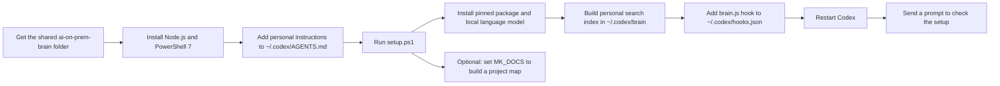
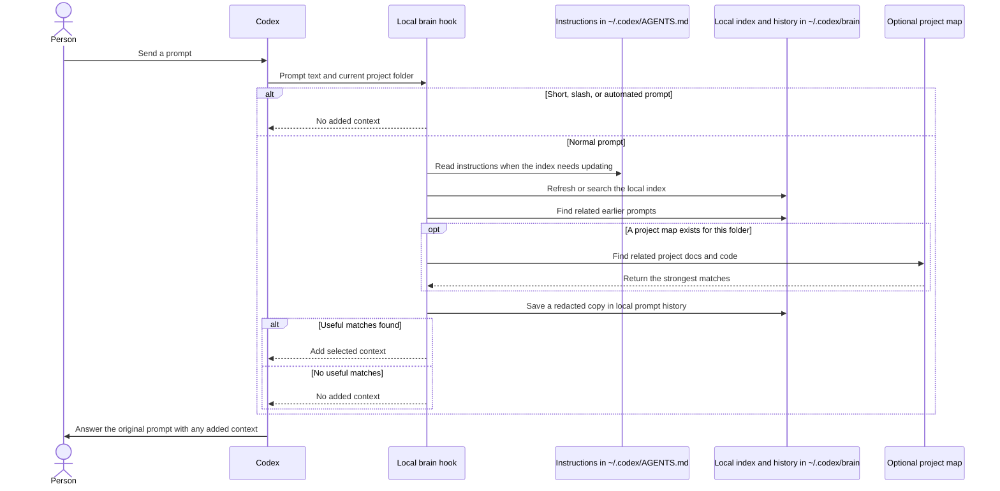

# Workflows

This page explains how a person sets up the shared brain and what it does when they send a prompt to Codex. The setup steps are in [setup.md](setup.md).

## The main idea

The shared folder contains the brain program. Each person keeps their own instructions in `~/.codex/AGENTS.md` and their search index and prompt history under `~/.codex/brain`. Codex sends each prompt through the local brain hook. The brain can add a few useful notes or earlier related prompts to Codex's context. Codex still answers the prompt as usual.

## One-time setup

The setup downloads software and a small model once. The brain uses the model locally after that. Setup does not add or replace the Codex hook automatically; add its command to the existing `UserPromptSubmit` hook list and keep other entries. See [setup.md](setup.md) for the exact command.

## What happens to a prompt

A prompt is skipped by the hook when it starts with `/`, has fewer than four words, or is a system-generated notice. Other prompts are matched by words and synonyms. If the small local language model is installed, meaning is used too. The optional project map is searched only when one exists for the current folder. If the hook encounters an error, Codex continues without extra context.

## What stays on the person's computer

- `~/.codex/AGENTS.md`, optional preferences, and personal memory notes
- The rules graph, meaning vectors, and optional project indexes in `~/.codex/brain`
- Prompt history in `~/.codex/brain/history`, saved as readable monthly text files

The export excludes the source user's `history` folder. Each recipient's own history is created locally when the hook first saves a qualifying prompt. Secret removal uses patterns and cannot guarantee that every secret is caught, so do not put credentials in prompts.